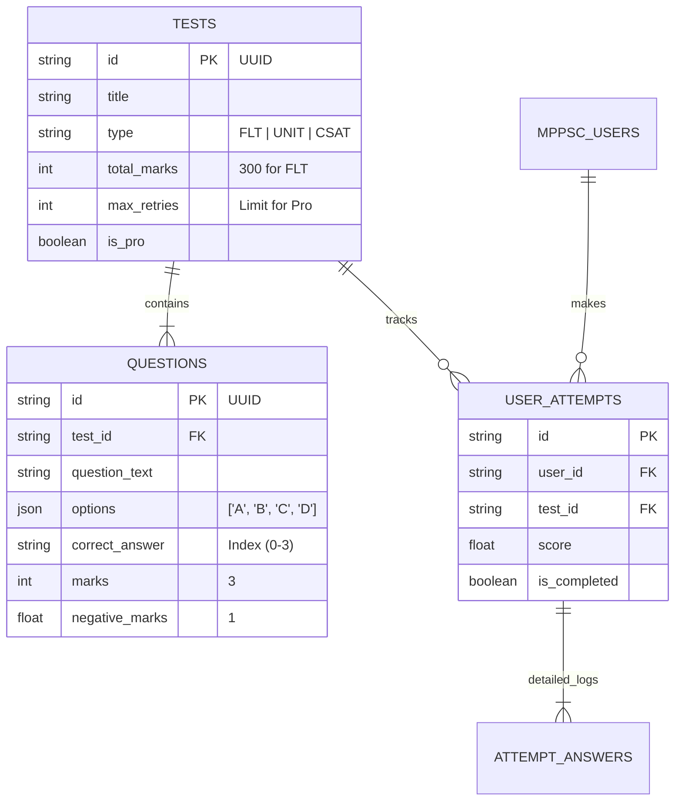

# MPPSC 2026 Data Architecture & Content Guide

This guide explains how the Test Series data is structured, how it flows from the database to the UI, and how you can add or update questions.

## 1. Database Structure (Schema)

We use a relational database (Turso/SQLite) with **Drizzle ORM**.

### 🧜‍♀️ Entity Relationships



### 📋 Key Tables Explained

| Table Name          | Purpose                                | Key Fields                                  | 2026 Pattern Update                           |
| :------------------ | :------------------------------------- | :------------------------------------------ | :-------------------------------------------- |
| **`tests`**         | The "Header" for any exam.             | `id`, `slug`, `type`, `unitId`              | `totalMarks` = 300, `maxRetries` logic added. |
| **`questions`**     | Individual questions linked to a test. | `testId`, `options` (JSON), `correctAnswer` | `marks` = 3, `negativeMarks` = 1.             |
| **`user_attempts`** | Stores a user's session history.       | `score`, `startTime`, `endTime`             | Stores the final calculated score.            |

---

## 2. Data Flow: How it Works?

### Step 1: User Selects a Test

- **Action**: User clicks "Start Unit Test" on `Unit 1` page.
- **Logic**: The app checks the URL (e.g., `/syllabus/quiz/play?unitId=unit_1`).

### Step 2: Fetching Questions

- **Backend**: The server (`QuizPlayPage`) queries the `tests` table:
  > _"Find me the latest test where `type='UNIT'` AND `unitId='unit_1'`"_
- **Result**: It finds the test ID (e.g., `test_123`) and then fetching its `questions`.

### Step 3: Playing & Scoring

- **Frontend**: User answers questions.
- **Submission**: On submit, the server calculates score:
  $$ \text{Score} = (\text{Correct} \times 3) - (\text{Wrong} \times 1) $$
- **Saving**: The result is saved to `user_attempts`.

---

## 3. How to Update/Add Data?

You have two main ways to update data:

### Method A: Using the Seed Script (Developer Way)

Best for bulk updates or resetting data.

1.  Open `src/scripts/seed-quiz-data.ts`.
2.  Locate the `realUnit1Questions` or `realFLTQuestions` arrays.
3.  Add a new object to the array:
    ```typescript
    {
        question: "New Question Text Here?",
        options: ["Option A", "Option B", "Option C", "Option D"],
        correctAnswer: 0, // 0 means Option A is correct
        explanation: "Detail explanation...",
        marks: 3,        // OPTIONAL: Defaults to 3
        negativeMarks: 1 // OPTIONAL: Defaults to 1
    }
    ```
4.  Run the script:
    ```bash
    npx tsx src/scripts/seed-quiz-data.ts
    ```
    _Note: This script currently **deletes** old questions for the specific test IDs it manages and re-inserts them to avoid duplicates._

### Method B: Future Admin Panel (Non-Tech Way)

We have a placeholder `/admin/upload` page where you can upload a JSON file.
**JSON Format:**

```json
{
  "title": "New FLT Test",
  "questions": [
    {
      "question": "...",
      "options": [...],
      "correctAnswer": 1
    }
  ]
}
```

## 4. Marking Scheme Configuration

Currently hardcoded in `seed-quiz-data.ts` for consistency:

- **FLT / General**:
  - Marks per Question: **3**
  - Negative Marking: **1** (3 \* 1/3)
  - Total Marks: **300** (for 100 questions)

- **Retries**:
  - Unit Tests: **5 Attempts**
  - FLT: **2 Attempts**
  - Free Users: **1 Attempt** (Handled in `QuizPlayClient.tsx`)

---
